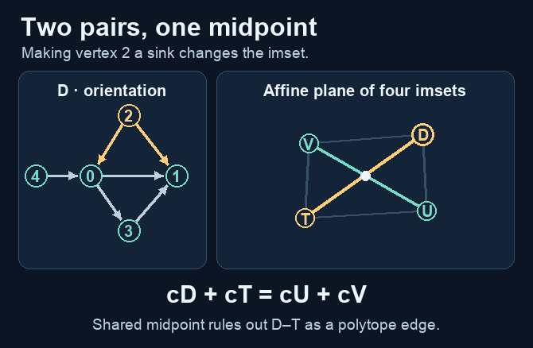

# A five-vertex counterexample to the characteristic imset sink conjecture

Making vertex 2 a sink in a five-vertex DAG changes its characteristic imset. The two imsets share their midpoint with a different pair, so their segment cannot be a polytope edge. This answers Restadh’s Conjecture 1. The earlier full five-vertex edge census already classified the pair. [Original conjecture, p. 11](https://arxiv.org/pdf/2302.03647v2#page=11)

[Paper PDF](paper/manuscript.pdf) · [LaTeX source](paper/manuscript.tex) · [Proof outline](proof/PROBLEM_AND_PROOF.md)

## Two pairs, one midpoint

The sink rewrite takes $D$ to $T$. Two further orientations $U,V$ give $c_D+c_T=c_U+c_V$. A face containing the midpoint must contain both other endpoints. The binary vectors $c_U,c_V$ are distinct from both ends of the proposed edge.

[Download the offline explorer ZIP](https://raw.githubusercontent.com/DannyExperiments/characteristic-imset-sink-counterexample/v1.0.0/visualization/characteristic-imset-sink-counterexample-explorer.zip) · [Worked example](visualization/README.md)

## Minimality, lift and checks

The exact replay finds integer exposing functionals for every imset-changing pair on at most four vertices. Leaves attached at vertex 4 preserve the midpoint identity and give connected counterexamples of every order from five onward. The proposed diameter proof via sink-edge moves fails. The diameter bound remains separate. [Claim scope](CLAIM_SCOPE_AND_LIMITATIONS.md) · [Literature audit](audits/public_safe_reports/LITERATURE_AUDIT.md)

A partial Lean certificate checks the exact sink rewrite, distinct supports, affected coordinates and midpoint equality on the four five-vertex DAGs. Internally reviewed, not peer reviewed. [Reproducibility](REPRODUCIBILITY.md) · [Technical disclosure](AI_DISCLOSURE.md)

DannyExperiments is the preferred citation identity. [Release v1.0.0](https://github.com/DannyExperiments/characteristic-imset-sink-counterexample/releases/tag/v1.0.0) · [Version DOI](https://doi.org/10.5281/zenodo.24572843) · [Citation metadata](CITATION.cff)
